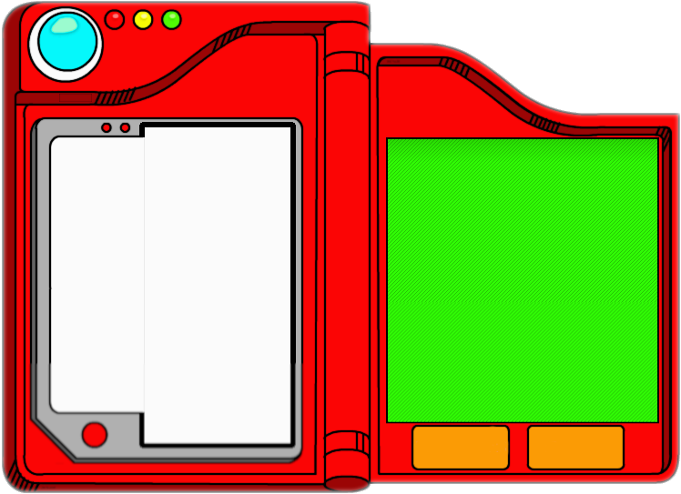
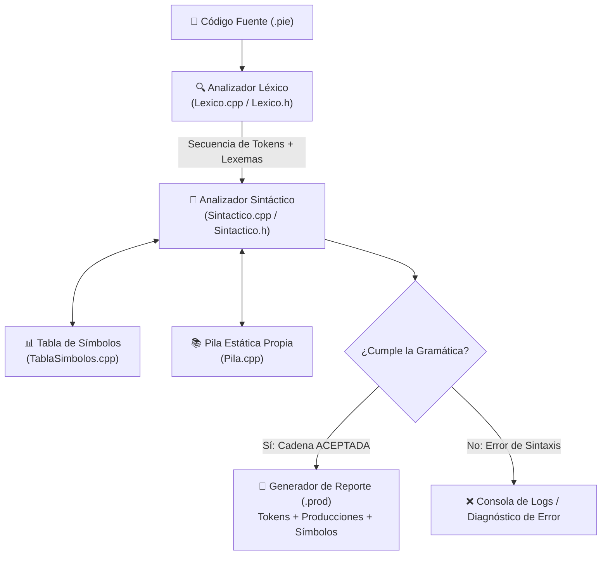
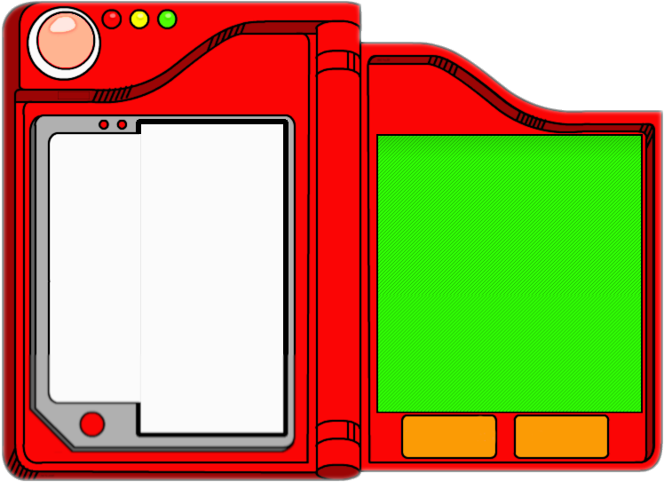

# <p align="center">⚡ PokeCompilator ⚡</p>
<p align="center">
  <strong>Compilador e IDE temático retro para el lenguaje <em>Basic pie</em></strong><br>
  <em>Analizador Léxico y Analizador Sintáctico desarrollados 100% desde cero en C++ y Qt.</em>
</p>

<p align="center">
  
</p>

<p align="center">
  
  
  
  
  
  
</p>

---

## 👥 Creadores y Desarrolladores Principales

Este proyecto fue concebido, diseñado e implementado por:

* 🔴 **Juan Pablo Chávez Ramírez** ([@Tyreans](https://github.com/Tyreans))
* 🔵 **Luis Antonio Cuevas Ortiz** (*LuisPies*)

> 💡 **Nota de autoría:**  
> El núcleo fundamental de este compilador radica en la construcción **artesanal y matemática desde cero** del **Analizador Léxico (Lexer)** y del **Analizador Sintáctico (Parser)** con su respectiva Gramática y Tabla de Transiciones (`Tabla_M`), sin emplear generadores automáticos externos como *Flex, Lex, Bison o Yacc*.

---

## 📖 Tabla de Contenido

1. [Visión General del Proyecto](#-visión-general-del-proyecto)
2. [El Dialecto: Basic pie](#-el-dialecto-basic-pie)
3. [Arquitectura del Compilador](#-arquitectura-del-compilador)
4. [Analizador Léxico (Desde Cero)](#-analizador-léxico-desde-cero)
5. [Analizador Sintáctico (Desde Cero)](#-analizador-sintáctico-desde-cero)
6. [Gramática Formal (BNF)](#-gramática-formal-bnf)
7. [Tabla de Símbolos y Estructuras Propias](#-tabla-de-símbolos-y-estructuras-propias)
8. [El IDE Temático Pokémon en Qt](#-el-ide-temático-pokémon-en-qt)
9. [Flujo de Compilación y Archivos `.pie` / `.prod`](#-flujo-de-compilación-y-archivos-pie--prod)
10. [Ejemplo Completo de Código](#-ejemplo-completo-de-código)
11. [Estructura del Repositorio](#-estructura-del-repositorio)
12. [Guía de Compilación y Ejecución](#-guía-de-compilación-y-ejecución)
13. [Créditos y Licencia](#-créditos-y-licencia)

---

## 🎮 Visión General del Proyecto

**PokeCompilator** es un entorno interactivo y compilador temático de Pokémon desarrollado en **C++17** sobre el framework **Qt**. Proporciona una suite completa que integra:

- Un **IDE retro estilo Pokédex** con tipografía pixelada (*Minecraft.ttf*).
- Un editor de texto con **Syntax Highlighter en tiempo real**.
- Un explorador de archivos con iconos y retroalimentación reactiva.
- Un **motor de compilación propio** que ejecuta análisis léxico y sintáctico con trazabilidad paso a paso de producciones gramaticales.
- Generación de reportes de salida (`.prod`) con la tabla de tokens, árbol de derivaciones y tabla de símbolos.

---

## 🥧 El Dialecto: *Basic pie*

**Basic pie** es una variante personalizada y modernizada de BASIC diseñada específicamente para este compilador. 

### Características del Lenguaje:
1. **Sensibilidad a líneas:** Las instrucciones están delimitadas por saltos de línea (`SALTO`).
2. **Tipado por Sigils (Sufijos):** El tipo de dato de un identificador queda determinado por el carácter final del nombre:
   | Sufijo | Tipo de Dato | Ejemplo de Identificador | Descripción |
   |:---:|:---:|:---:|:---|
   | `$` | `ID_CADENA` | `nombre$`, `mensaje$` | Cadena de texto (*string*) |
   | `%` | `ID_ENTERO` | `nivel%`, `vida%` | Número entero (tipo por defecto) |
   | `!` | `ID_FLOAT` | `ratio!`, `ataque!` | Número flotante con precisión decimal |
   | `~` | `ID_BOOLEANO` | `vivo~`, `capturado~` | Valor de verdad (`TRUE` / `FALSE`) |
   | *(sin sufijo)* | `ID_ENTERO` | `x`, `contador` | Por compatibilidad se asume entero |

3. **Operadores Lógicos Modernos:** A diferencia del BASIC original, soporta operadores de comparación modernos (`==`, `!=`, `<`, `>`, `<=`, `>=`).
4. **Sentencias de Control:**
   - Bloques condicionales: `IF ... THEN` con ramas `ELSEIF`, `ELSE` y cierre formal `ENDIF`.
   - Bucles: `WHILE ... WEND`.
5. **Declaración y Asignación:**
   - Declaración de variables mediante `DIM variable(TIPO)`.
   - Asignación dinámica: `variable = expresion [+|-|*|/|%] expresion`.
6. **Entrada/Salida:**
   - Instrucción `PRINT` con operador de concatenación `;`.
7. **Comentarios:**
   - Líneas de comentario mediante la palabra clave `REM`.

---

## 🏗 Arquitectura del Compilador

El pipeline de compilación opera en fases limpias y desacopladas:



---

## 🔍 Analizador Léxico (Desde Cero)

Implementado en [`Lexico.h`](file:///home/tyreans/projects/PokeCompilator/Lexico.h) y [`Lexico.cpp`](file:///home/tyreans/projects/PokeCompilator/Lexico.cpp).

### ¿Por qué desde cero?
No se utilizó ninguna biblioteca externa de expresiones regulares en tiempo de escaneo ni generadores de autómatas. El analizador lee el buffer de caracteres carácter por carácter usando una máquina de estados determinista artesanal:

* **Separadores y Saltos:** Descarta espacios y tabuladores, consolidando saltos de línea consecutivos en tokens `SALTO`.
* **Comentarios:** Al encontrar la secuencia `REM` (case-insensitive), descarta el contenido hasta el fin de línea.
* **Strings:** Escaneo de literales entre comillas `"` preservando el lexema completo.
* **Números (Enteros y Flotantes):** Detección de dígitos continuos y reconocimiento de punto decimal para diferenciar `ENTERO` de `FLOAT`.
* **Identificadores y Palabras Reservadas:**
  - Extrae el lexema alfanumérico junto a sus sigils permitidos (`$`, `%`, `!`, `~`).
  - Convierte a mayúsculas para comparar contra el diccionario de palabras reservadas (`IF`, `THEN`, `ELSE`, `ELSEIF`, `WHILE`, `ENDIF`, `WEND`, `PRINT`, `DIM`, `TRUE`, `FALSE`).
  - Si no es palabra reservada, determina el tipo mediante su sigil terminal.
* **Operadores Relacionales Compuestos:** Reconocimiento con lookahead de `==`, `!=`, `>=`, `<=`.
* **Operadores Aritméticos y Delimitadores:** `+`, `-`, `*`, `/`, `%`, `=`, `(`, `)`, `;`.
* **Marcador de Fin de Cadena:** Inserción del token centinela `@` (`TokenType::END`).
* **Diagnóstico de errores léxicos:** Cualquier carácter no reconocido es reportado inmediatamente al logger.

---

## 🌳 Analizador Sintáctico (Desde Cero)

Implementado en [`Sintactico.h`](file:///home/tyreans/projects/PokeCompilator/Sintactico.h) y [`Sintactico.cpp`](file:///home/tyreans/projects/PokeCompilator/Sintactico.cpp).

El parser es un **analizador sintáctico descendente predictivo** diseñado sobre la gramática formal del lenguaje:

* **Trazabilidad en Vivo:** Cada vez que una regla gramatical es invocada o reducida, emite la producción aplicada a la consola (e.g. `<PROGRAMA> -> <INSTRUCCION> <PROGRAMA> | @`).
* **Sincronización y Recuperación:** Métodos auxiliares `aceptar()`, `esperar()` y `analizarListaInstruccionesHasta()` para validar la estructura de bloques anidados (`IF-THEN-ELSEIF-ELSE-ENDIF` y `WHILE-WEND`).
* **Integración Semántica Básica:**
  - Verifica si las variables han sido previamente declaradas en `DIM`.
  - Registra automáticamente variables creadas por asignación directa.
  - Alerta ante el uso de variables no inicializadas o no declaradas.
* **Reporte de Errores con Contexto:** Indica con precisión el token que causó el fallo y la regla que se esperaba satisfacer.

---

## 📐 Gramática Formal (BNF)

La gramática libre de contexto que rige a **Basic pie** se describe a continuación:

```bnf
<PROGRAMA>               ::= <INSTRUCCION> <PROGRAMA> 
                           | @

<INSTRUCCION>            ::= <DIM> 
                           | <E_IF> 
                           | <E_BUCLE> 
                           | <PRINT> 
                           | <ASIGNACION>

<DIM>                    ::= DIM <IDENTIFICADOR> "(" ENTERO ")" SALTO

<ASIGNACION>             ::= <IDENTIFICADOR> "=" <EXPRESION> <OPERACION_ARITMETICA> SALTO

<PRINT>                  ::= PRINT <EXPRESION> ( ";" <EXPRESION> )* SALTO

<E_IF>                   ::= IF <EXPRESION> <OP_LOGICO> <EXPRESION> THEN SALTO 
                               <LISTA_INSTRUCCIONES> 
                             [ ELSEIF <EXPRESION> <OP_LOGICO> <EXPRESION> THEN SALTO <LISTA_INSTRUCCIONES> ]* 
                             [ ELSE SALTO <LISTA_INSTRUCCIONES> ]? 
                             ENDIF SALTO

<E_BUCLE>                ::= WHILE <EXPRESION> <OP_LOGICO> <EXPRESION> SALTO 
                               <LISTA_INSTRUCCIONES> 
                             WEND SALTO

<EXPRESION>              ::= <IDENTIFICADOR> 
                           | CADENA_TEXTO 
                           | ENTERO 
                           | FLOAT 
                           | BOOLEANO

<OPERACION_ARITMETICA>   ::= ( "+" | "-" | "*" | "/" | "%" ) <EXPRESION> 
                           | ε

<OP_LOGICO>              ::= ">" | "<" | ">=" | "<=" | "!=" | "=="
```

---

## 📊 Tabla de Símbolos y Estructuras Propias

### 1. `TablaSimbolos` ([`TablaSimbolos.h`](file:///home/tyreans/projects/PokeCompilator/TablaSimbolos.h) / [`TablaSimbolos.cpp`](file:///home/tyreans/projects/PokeCompilator/TablaSimbolos.cpp))
Estructura encargada de registrar cada variable, garantizando unicidad de declaración y mapeando su identificador a su tipo correspondiente (`CADENA`, `ENTERO`, `FLOAT`, `BOOLEANO`).

### 2. `Pila` ([`Pila.h`](file:///home/tyreans/projects/PokeCompilator/Pila.h) / [`Pila.cpp`](file:///home/tyreans/projects/PokeCompilator/Pila.cpp))
Una estructura de datos de pila (Stack LIFO) codificada de forma manual con arreglo estático de capacidad `MAX = 100`, con primitivas:
- `insertapila(elem)` (Push con validación de overflow)
- `eliminapila()` (Pop con validación de underflow)
- `obtenerCima()` (Top/Peek)
- `estaVacia()`, `estaLlena()`, `vaciar()`

### 3. `RegistradorConsola` ([`RegistradorConsola.h`](file:///home/tyreans/projects/PokeCompilator/RegistradorConsola.h))
Componente que canaliza los eventos tanto a `stdout` como al buffer que finalmente se persiste en los archivos `.prod`.

---

## 🎨 El IDE Temático Pokémon en Qt

<p align="center">
  
</p>

La interfaz de usuario no es una simple ventana genérica: es una experiencia interactiva temática:

* **Skins Dinámicos:** El fondo cambia entre `MAIN.png` y `MAIN2.png` para dar retroalimentación visual al usuario cuando el archivo sufre modificaciones.
* **Fuente Pixel-Art Retro:** Integra directamente `Minecraft.ttf` mediante `QFontDatabase` en todo el editor y explorador.
* **Resaltado de Sintaxis en Vivo (`resaltador.cpp`):**
  - <b style="color:#B51EBA;">Púrpura:</b> Palabras clave (`IF`, `WHILE`, `DIM`, `PRINT`, etc.).
  - <b style="color:#0934B8;">Azul Marino:</b> Identificadores tipados (`a$`, `b%`, `c!`, `d~`).
  - <b style="color:#A31707;">Rojo Oscuro:</b> Cadenas de texto entre comillas (`"..."`).
  - <b style="color:#06D64B;">Verde:</b> Números enteros y de punto flotante.
  - **Negro:** Operadores aritméticos, lógicos y delimitadores.
* **Explorador con Distinción de Iconos:**
  - 🟡 **Archivos `.pie`:** Icono de Pikachu / Pokémon (`pokemon.png`). Son editables.
  - 🔴 **Archivos `.prod`:** Icono de Entrenador Pokémon (`avatar.png`). Modo sólo lectura para preservar la integridad del reporte.

---

## 🔄 Flujo de Compilación y Archivos `.pie` / `.prod`

1. **Creación o Carga:** Abre o crea un archivo con extensión `.pie`.
2. **Edición:** Modifica tu código fuente con asistencia visual de sintaxis.
3. **Generación (`btnProd`):**
   - El compilador ejecuta el análisis léxico y luego el sintáctico.
   - Si la cadena es aceptada, construye un archivo espejo con el mismo nombre y extensión `.prod`.
4. **Visualización:** El archivo `.prod` aparece de inmediato en la lista con su icono de avatar y puede ser inspeccionado para auditar la traza de derivaciones gramaticales.

---

## 💻 Ejemplo Completo de Código

### Entrada: `entrenador.pie`
```basic
REM === BATALLA POKEMON EN BASIC PIE ===
DIM NOMBRE$(10)
NOMBRE$ = "Pikachu"

NIVEL% = 25
VIDA! = 84.50
ESTADO~ = TRUE

IF NIVEL% >= 20 THEN
    PRINT "Pokemon Apto para Batalla: " ; NOMBRE$
    WHILE NIVEL% > 20
        PRINT "Nivel actual: " ; NIVEL%
        NIVEL% = NIVEL% - 1
    WEND
ELSE
    PRINT "Nivel insuficiente para competir"
ENDIF

PRINT "Fin del entrenamiento"
```

### Salida: `entrenador.prod`
```text
PokeCompilator - Analizador para Basic pie
Basic Modificado para aceptar operadores logicos modernos
Tabla_M y Gramatica creada por LuisPies y Tyreans

TOKENS RECONOCIDOS (43)
 [0] SALTO
 [1] DIM
 [2] ID_CADENA
 [3] (
 [4] ENTERO
 [5] )
 [6] SALTO
 ...

- - - ANALIZADOR SINTACTICO - Inicio - - -
<PROGRAMA> -> <INSTRUCCION> <PROGRAMA> | @
<INSTRUCCION> -> DIM | IF | WHILE | PRINT | ASIGNACION
<DIM> -> DIM <IDENTIFICADOR> ( ENTERO ) SALTO
<INSTRUCCION> -> DIM | IF | WHILE | PRINT | ASIGNACION
<ASIGNACION> -> <IDENTIFICADOR> = <EXPRESION> <OPERACION_ARITMETICA> SALTO
<INSTRUCCION> -> DIM | IF | WHILE | PRINT | ASIGNACION
<E_IF> -> IF <EXPRESION> <OP_LOGICO> <EXPRESION> THEN SALTO <M_INSTRUCCION> <C_IF> ENDIF SALTO
<E_BUCLE> -> WHILE <EXPRESION> <OP_LOGICO> <EXPRESION> SALTO <M_INSTRUCCION> WEND SALTO
...
Cadena ACEPTADA

TABLA DE SIMBOLOS:
  ESTADO~ : BOOLEANO
  NIVEL%  : ENTERO
  NOMBRE$ : CADENA
  VIDA!   : FLOAT
```

---

## 📂 Estructura del Repositorio

```text
PokeCompilator/
├── 📁 FONTS/                  # Fuentes tipográficas (Minecraft.ttf)
├── 📁 IMAGES/                 # Sprites, avatares, fondos y texturas del IDE
├── dialog.h / dialog.cpp      # Interfaz gráfica principal (Qt Dialog)
├── dialog.ui                  # Layout gráfico de la ventana
├── images.qrc                 # Qt Resource Collection (imágenes y fuentes)
├── Lexico.h / Lexico.cpp      # ⚙️ Analizador Léxico artesanal
├── Sintactico.h / Sintactico.cpp # ⚙️ Analizador Sintáctico artesanal predictivo
├── Token.h                    # Definición de enumeraciones y estructura de Tokens
├── TablaSimbolos.h / .cpp     # Estructura de control semántico de identificadores
├── Pila.h / Pila.cpp          # Pila LIFO artesanal
├── RegistradorConsola.h       # Gestor y recolector de logs
├── resaltador.h / .cpp        # Motor QSyntaxHighlighter con reglas Regex
├── main.cpp                   # Punto de entrada de la aplicación Qt
├── Poke_Compilator.pro        # Archivo de configuración de compilación qmake
└── README.md                  # Documentación oficial del proyecto
```

---

## 🚀 Guía de Compilación y Ejecución

### Prerrequisitos
* Sistema Operativo: Linux / Windows / macOS
* Compilador compatible con **C++17** (`g++`, `clang++`, `MSVC`)
* **Qt 5** o **Qt 6** (módulos `core`, `gui`, `widgets`)
* Herramienta `qmake` (o `qmake6`) y `make`

### Compilación desde Terminal (Linux)

1. Clonar el repositorio:
   ```bash
   git clone https://github.com/Tyreans/PokeCompilator.git
   cd PokeCompilator
   ```

2. Generar el `Makefile` con qmake:
   ```bash
   qmake6 Poke_Compilator.pro
   # O en sistemas con Qt 5:
   # qmake Poke_Compilator.pro
   ```

3. Compilar el proyecto:
   ```bash
   make -j$(nproc)
   ```

4. Ejecutar PokeCompilator:
   ```bash
   ./Poke_Compilator
   ```

### Compilación desde Qt Creator
1. Abre **Qt Creator**.
2. Selecciona `Archivo` > `Abrir archivo o proyecto...` y elige `Poke_Compilator.pro`.
3. Selecciona tu kit de compilación (Desktop Qt 6 / Qt 5).
4. Presiona `Ctrl + R` para compilar y ejecutar automáticamente.

---

## 🏆 Créditos y Reconocimientos

Proyecto desarrollado para la materia de **Lenguajes y Autómatas / Compiladores**.

* **Juan Pablo Chávez Ramírez** - Arquitectura general, analizador léxico/sintáctico, integración con Qt.
* **Luis Antonio Cuevas Ortiz** - Gramática formal, tabla de transiciones sintácticas `Tabla_M`, estructuras de datos.

<p align="center">
  Hecho con ☕, C++ y pasión por los compiladores y Pokémon ⚡
</p>
